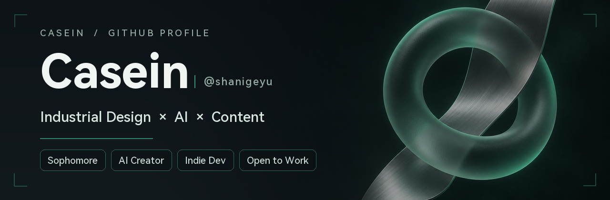

**English**　·　[中文](README.zh-CN.md)

Shandong University of Science and Technology · Industrial Design · Sophomore　｜　Preparing for a master's abroad　｜　Class by day, models by night

 

---

## What I'm Doing Now

- **School first** — Second-year Industrial Design at SDUST. Coursework, portfolio and language scores all moving at once; the goal is a master's programme abroad.
- **Teaching myself AI** — How LLMs actually work, agent orchestration, context and workflows, multimodal generation. Everything I learn goes straight into something that runs — that's the whole reason this profile exists.
- **Making content** — AI explainers on Bilibili and Douyin: 5,000 followers and a 5,000-person private community (as of early November). I run a lot of models side by side, so I know each one's temper.
- **Shipping products** — A desktop app I built myself, plus AI products of my own. Learning monetisation the hard way.

> Three tracks at once, so replies can be slow — but every message gets read.

## Selected Projects

### 🎬 [VAT · AI video editor](https://github.com/shanigeyu/VAT)&emsp;`Python`&ensp;`Desktop`

Give it a topic and the AI walks through outline, script, storyboard, original motion graphics, voiceover, subtitles and the finished cut. A local desktop workbench: projects stay on your machine, no server, no data collection, free forever. The model channel accepts Codex CLI / DeepSeek Harness / OpenAI-compatible / Anthropic / Gemini / local Ollama.

### 🧪 [dark-tech-explainer](https://github.com/shanigeyu/dark-tech-explainer)&emsp;`SKILL`&ensp;`HTML`&ensp;`GSAP`&ensp;`MIT`

A drop-in skill for making AI explainer and product videos in a minimal dark-tech visual language: near-black canvas, a single fluorescent accent, strict grid, modular info cards. Clone it into your skills directory and go.

### 🔒 Claude-based closed-source project&emsp;`In development`

A closed-source project built on Claude, currently in development. Details stay private for now.

## Tools & Skills

- **Engineering** — Python · FFmpeg · Tkinter · HyperFrames
- **AI** — LLM applications · agent orchestration · RAG · AIGC image & voice · prompt engineering
- **Content** — visual design · short-form video operations

## Awards & Certifications

**AI & Algorithms**

- AI Trainer (Level 3)
- AI Algorithm Elite Competition · Provincial 3rd Prize

**Design & Art**

- Lanqiao Cup · Visual Design · Provincial 3rd Prize
- College Digital Media Competition · AIGC track · Provincial 2nd Prize
- North American Environmental Protection Art Competition · Silver
- Japan CADA · Bronze

**Cross-field credentials**

- Psychological Counselling Professional Training (Level 3)
- All-Media Operations Specialist
- Medical Companion (patient escort)

The range is wide, but each one was actually earned.

## Long-Term Interests · Say Hi

- **People & minds** — psychology · sociology · neuroscience · communication
- **Money & the world** — investing · finance · monetary policy · technology · international affairs
- **The body** — sports science · nutrition · sports rehab

Not a reading list — things I already do: one year investing, seven months training. If you've already hit the walls in any of these, I'd like to hear about them.

## Get In Touch

**Work, questions, or just to talk — email reaches me fastest:**

📮 **[2900198897@qq.com](mailto:2900198897@qq.com)**

💬 WeChat **`bcybqxz`** — say who you are, or the request gets buried

**Elsewhere**　[Bilibili](https://space.bilibili.com/508624051)　·　Douyin `yuruecheng40`

Three things make a reply fast: <b>what you want</b> · <b>when you need it</b> · <b>budget or scope</b>.

 
Last updated · Nov 2026

