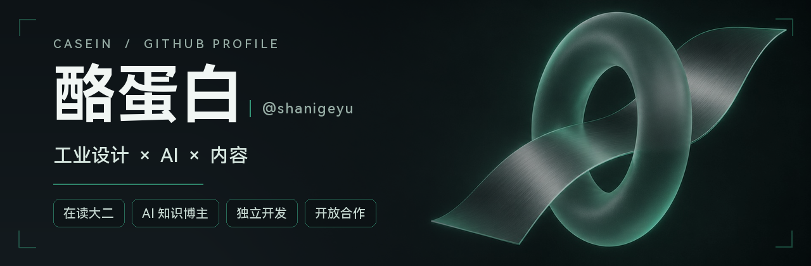

[English](README.md)　·　**中文**

山东科技大学 · 工业设计 · 大二　｜　目标出国读研　｜　白天上课，晚上跑模型

 

---

## 现在在做什么

- **学业为主** — 山东科技大学工业设计大二。课程、作品集、语言成绩一起推进，目标是出国读研。
- **自学 AI** — 大模型原理、Agent 编排、上下文与工作流、多模态生成。学一点就立刻拿去做成能跑的东西，这也是这个账号存在的理由。
- **做内容** — B站 / 抖音 AI 知识分享，5,000 粉、5,000 人私域（截至 11 月初）。长期同时跑很多家大模型，因此知道它们各自的脾气。
- **做产品** — 自研桌面软件 + 自己做的 AI 产品，一边试变现一边踩坑。

> 三件事同时做，所以回复可能慢一点 —— 但每条都会看。

## 在做的项目

### 🎬 [VAT · AI 自动剪辑软件](https://github.com/shanigeyu/VAT)&emsp;`Python`&ensp;`本地桌面端`

一句选题，AI 依次完成策划、文案、分镜、原创动效、配音、字幕和成片。本地工作台，项目只存在自己电脑里，没有服务器、不收集数据、永久免费。模型通道可以接 Codex CLI / DeepSeek Harness / OpenAI 兼容 / Anthropic / Gemini / 本机 Ollama。

### 🧪 [dark-tech-explainer](https://github.com/shanigeyu/dark-tech-explainer)&emsp;`SKILL`&ensp;`HTML`&ensp;`GSAP`&ensp;`MIT`

一个开箱即用的 skill：用极简暗黑科技视觉做 AI 科普 / 产品解释类视频。近黑背景、单点荧光强调、严格网格、模块化信息卡。`git clone` 进 skill 目录就能开工。

### 🔒 Claude 相关闭源项目&emsp;`开发中`

基于 Claude 的闭源项目，正在开发中，细节暂时不公开。

## 工具与能力

- **工程侧** — Python · FFmpeg · Tkinter · HyperFrames
- **AI 侧** — LLM 应用 · Agent 编排 · RAG · AIGC 生图与配音 · 提示词工程
- **内容侧** — 视觉设计 · 短视频运营

## 证书与奖项

**AI 与算法**

- 人工智能训练师（三级）
- 人工智能算法精英大赛 · 省三等奖

**设计与艺术**

- 蓝桥杯 · 视觉设计 · 省三等奖
- 大学生数媒赛 · AIGC 方向 · 省二等奖
- 北美环境保护艺术创作赛 · 银奖
- 日本 CADA · 铜奖

**跨界资质**

- 心理咨询师专业技能培训（三级）
- 全媒体运营师
- 陪诊师

跨度是有点大，但每一张都认真考的。

## 长期胃口 · 欢迎来聊

- **人文社科** — 心理学 · 社会学 · 脑科学 · 传播学
- **钱与局势** — 投资 · 金融 · 货币政策 · 科技 · 国际形势与政策
- **身体** — 运动科学 · 营养学 · 运动康复

不是书单，是已经在做的事：投资跑了 1 年，健身 7 个月。如果你在这些方向上踩过坑，欢迎把坑说给我听。

## 找我

**合作、咨询、交个朋友，都走邮箱 —— 比平台私信快得多：**

📮 **[2900198897@qq.com](mailto:2900198897@qq.com)**

💬 微信 **`bcybqxz`**　— 加好友请写明来意，不然容易被埋掉

**其他平台**　[B站](https://space.bilibili.com/508624051)　·　抖音号 `yuruecheng40`

写清楚这三件事，回复会快很多：<b>想做什么</b> · <b>什么时候要</b> · <b>预算或合作方式</b>。

 
最后更新 · 2026.11

